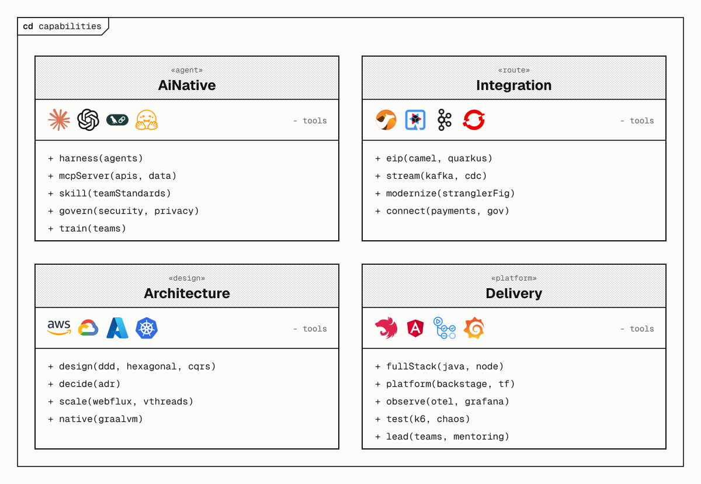

<picture>
  <source media="(max-width: 600px)" srcset="https://raw.githubusercontent.com/AZapata27/AZapata27/main/assets/header-mobile.svg">
  
</picture>

<picture>
  <source media="(max-width: 600px)" srcset="https://raw.githubusercontent.com/AZapata27/AZapata27/main/assets/sequence-mobile.svg">
  
</picture>

<picture>
  <source media="(max-width: 600px)" srcset="https://raw.githubusercontent.com/AZapata27/AZapata27/main/assets/classes-mobile.svg">
  
</picture>

<picture>
  <source media="(max-width: 600px)" srcset="https://raw.githubusercontent.com/AZapata27/AZapata27/main/assets/packages-mobile.svg">
  
</picture>

&nbsp;

 
