  

  
  

## 🤖 AI-first engineering

I build **with** AI and I build **AI**: agents, MCP servers and skills that plug LLMs into real systems — and I train teams to do the same.

  
  
  
  
  
  
  

## 🧭 Experience at a glance

- 🏗️ **Architecture** — Cloud-native microservices with DDD, Clean Architecture and event-driven design, aligned with the Well-Architected Framework.
- ⚡ **Streaming** — High-throughput pipelines on Kafka: Connect + Debezium for CDC, Kafka Streams and Schema Registry.
- 🔭 **Reliability** — End-to-end observability, load testing with k6 and Gatling, JVM profiling and chaos engineering.
- 👥 **Leadership** — 200+ people led over the last 5 years. I coach developers into senior and architect roles.

## 🛠️ Stack

| | |
|---|---|
| **Backend** |  |
| **Cloud** |  |
| **Data & streaming** |  &nbsp; Oracle · Neo4j · Spark |
| **Frontend** |  |
| **Observability** |  &nbsp; OpenTelemetry · Loki · Tempo |
