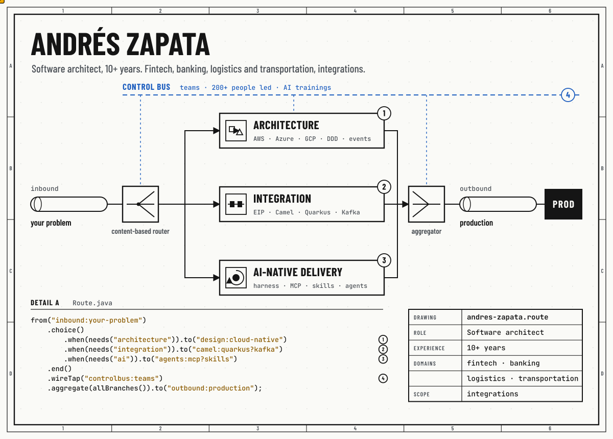
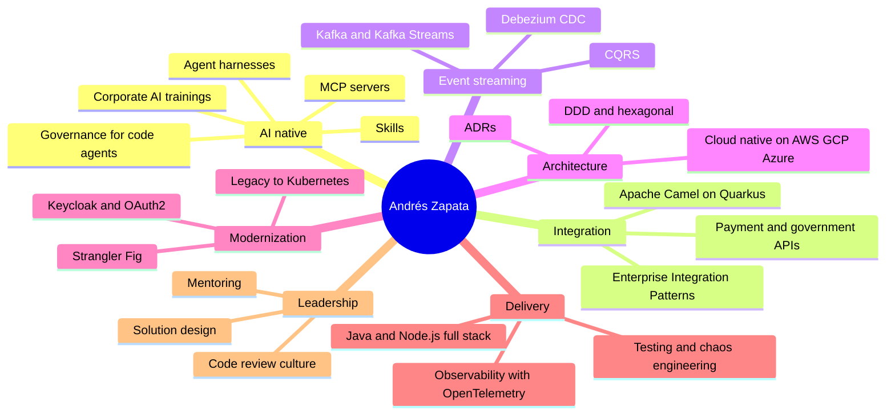

<picture>
  <source media="(max-width: 600px)" srcset="https://raw.githubusercontent.com/AZapata27/AZapata27/main/assets/header-mobile.svg">
  
</picture>

<picture>
  <source media="(max-width: 600px)" srcset="https://raw.githubusercontent.com/AZapata27/AZapata27/main/assets/hero-mobile.svg">
  
</picture>

<picture>
  <source media="(max-width: 600px)" srcset="https://raw.githubusercontent.com/AZapata27/AZapata27/main/assets/stack-mobile.svg">
  
</picture>

&nbsp;

 
